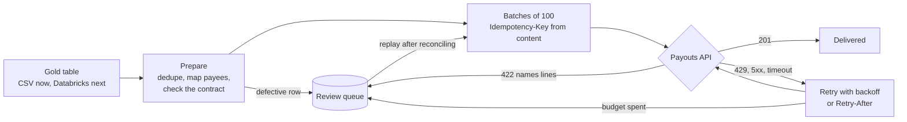

# Puente

Puente delivers rows from a data warehouse to a SaaS API without losing or duplicating them, even when the API misbehaves.

It reads monthly sales-commission data, checks it against the destination's contract and sends it to a payouts API in batches. Every row ends in one of two places: delivered exactly once, or parked in a review queue with a reason. Nothing disappears quietly.

The destination is a mock SaaS built for this project. It fails on purpose, the way vendor APIs do: expiring OAuth tokens, rate limits, transient 5xx errors, answers lost after a write, slow responses and a full outage.

## Results

Both runs get the same 10,326 rows and the same failure injection. 9% of calls get a transient 5xx and 2% hit a revoked token. 5% of writes are answered with a 504 after they landed, and 5% are answered only after the client timed out. On top of that come a rate limit of 10 calls per second and a 30-second outage.

| | Naive script | Puente |
|---|---:|---:|
| Payable rows delivered exactly once | 3,320 of 10,119 (32.8%) | 10,119 of 10,119 (100%) |
| Payable rows lost without a record | 5,997 | 0 |
| Rows paid twice (extra payouts) | 804 (904) | 0 |
| Defective rows sent downstream | 4 | 0 |
| Defective rows parked with the right reason | 0 of 177 | 177 of 177 |
| Wall time | 57 s | 52 s |

The naive script is what a quick cron job looks like: batches of 100, three tries per request with a fixed pause, a new Idempotency-Key on every attempt and no validation ([demo/naive.py](demo/naive.py)). Full numbers in [reports/chaos_report.md](reports/chaos_report.md). Reproduce them with `python -m demo.benchmark`, about 2 minutes on a laptop.

## How it works



1. **Prepare.** Exact copies of a row are dropped and logged. Two different rows for the same rep and month go to review, because only a person can say which one is right. Reps with no payee in the destination, and rows that break the destination's published contract, go to review too.
2. **Send.** Lines go out in batches of 100. Each batch carries an Idempotency-Key derived from its content, so a retry after a timeout cannot be applied twice.
3. **Retry what is transient.** 429, 5xx, timeouts and network errors are retried with exponential backoff and full jitter, or after exactly the wait that Retry-After asks for. A 401 refreshes the OAuth token and tries again. A 422 that names bad lines parks those lines and resends the rest.
4. **Stop hammering.** When three batches in a row run out of retries, a circuit breaker opens, waits and lets one probe through before resuming.
5. **Replay safely.** Lines parked for transient reasons are replayed at the end of the run. Before resending, Puente asks the destination which of them already landed, because a write whose answer was lost looks exactly like a failed one.
6. **Account for everything.** `python -m puente reconcile` checks every business key: delivered once, waiting in review, or lost. Lost and paid twice must both be zero.

Every run writes JSON log lines to `logs/puente.jsonl` and a row with its counts to a SQLite ledger.

## Run it

Python 3.10 or newer.

```bash
python3 -m venv .venv && source .venv/bin/activate
pip install -e ".[dev]"
pytest
python -m demo.benchmark --quick
```

Step by step, against a mock that fails now and then:

```bash
docker compose up -d                  # or: MOCK_ERROR_RATE=0.05 uvicorn mock_saas.app:app --port 8000
python -m demo.generate --out data    # 10,326 rows with known defects
python -m puente sync --source data/gold_vendor_commissions.csv
python -m puente review
python -m puente reconcile --source data/gold_vendor_commissions.csv
python -m puente runs
```

Settings come from environment variables or a `.env` file, see [.env.example](.env.example).

## Layout

```
puente/      the connector: client, retry policy, circuit breaker, transform, sync, replay, reconcile, CLI
mock_saas/   the destination: a FastAPI app with OAuth, rate limits, pagination and failure injection
demo/        synthetic data with ground truth, the naive baseline and the benchmark
tests/       unit tests for each piece, plus end-to-end runs under failure injection
```

The connector depends on httpx and pydantic. The mock adds FastAPI and uvicorn. State lives in SQLite from the standard library.

## Design notes

- **Idempotency key from content, not a random id.** The same batch always gets the same key, so a retry or a re-run after a crash collapses into the write that already happened.
- **Reconcile before replay.** Idempotency keys expire and replayed batches are composed differently. Asking the destination what it already holds is what makes a resend safe.
- **Retry only what can change.** A 422 fails the same way every time, so it goes to review on the first answer. Retrying it would spend the rate limit and hide the problem.
- **The contract lives on the client too.** Checking rows against the vendor's documented schema before sending keeps one bad row from sinking a batch of 100.
- **Two kinds of review items.** Transient reasons (retries ran out, circuit open) are replayed by the machine. Data reasons (invalid row, unknown rep, conflicting duplicates, rejected by the destination) wait for a person.

## Roadmap

- [x] Stage 1: resilient core, mock SaaS and chaos benchmark
- [ ] Stage 2: Databricks Free Edition as the source, with Spark SQL building the gold table
- [ ] Stage 3: Zoho CRM Developer Edition as the system of record for sales reps
- [ ] Stage 4: data-quality checks and a human approval gate before any batch is sent
- [ ] Stage 5: Slack alerts and run metrics
- [ ] Stage 6: AI-assisted field mapping for onboarding a new SaaS, and triage of the review queue. The model only proposes: validation and a person approve, and the model never writes to the destination.

All data is synthetic.
